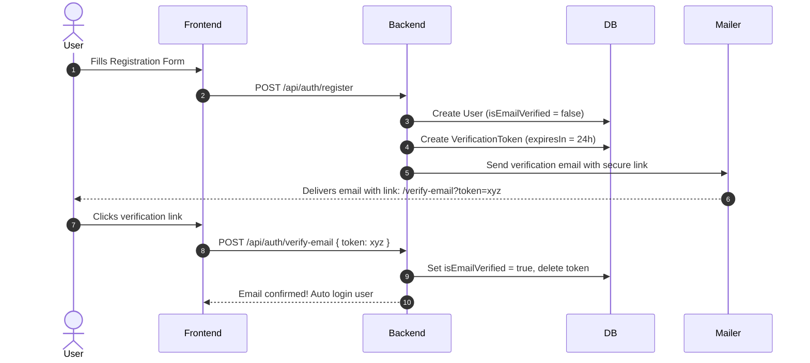
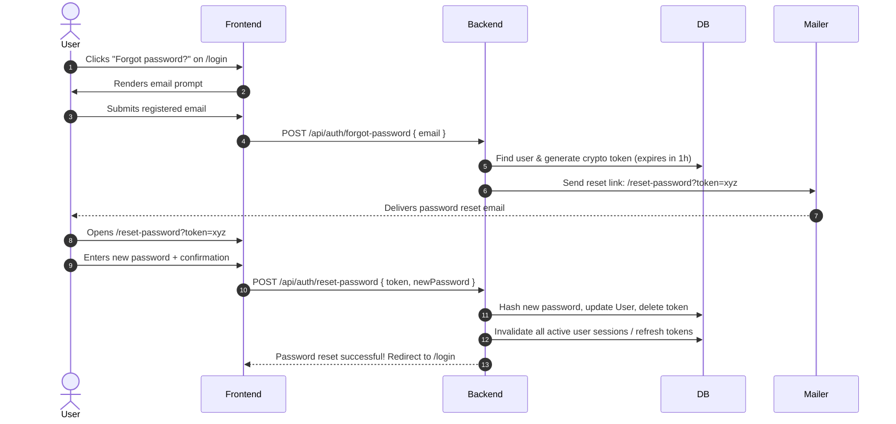

# Future Plans & Architecture Roadmap: SurveyBuilder

This document outlines architectural plans, schemas, and integration strategies for future feature expansions across monetization, identity security, onboarding experiences, and asset storage.

---

## 1. Subscription & Monetization Architecture

### 1.1 Tiered Plans Matrix

| Feature | Free Tier | Starter ($19/mo) | Professional ($49/mo) | Enterprise (Custom) |
| :--- | :--- | :--- | :--- | :--- |
| **Active Surveys** | Up to 3 | Up to 15 | Unlimited | Unlimited |
| **Monthly Responses** | 100 / month | 2,500 / month | 25,000 / month | Unlimited |
| **Question Types** | All Core Types | All + File Upload | All + NPS & Logic Jump | Custom Types |
| **Branding** | "Powered by SurveyBuilder" badge | Badge removable | Custom logo & domain | Custom CSS & domain |
| **Export Formats** | CSV only | CSV, JSON | CSV, JSON, Excel, PDF | Direct API, BigQuery |
| **Webhooks & Integrations** | None | Slack, Discord | Zapier, Webhooks, Google Sheets | Custom CRM integrations |
| **Team Collaboration** | 1 Member | 3 Members | 10 Members | Unlimited (SSO / SAML) |

---

### 1.2 Database Schema Extension (Prisma)

```prisma
enum SubscriptionTier {
  FREE
  STARTER
  PRO
  ENTERPRISE
}

enum SubscriptionStatus {
  ACTIVE
  TRIALING
  PAST_DUE
  CANCELED
  INCOMPLETE
}

model Subscription {
  id                   String             @id @default(uuid())
  userId               String             @unique
  user                 User               @relation(fields: [userId], references: [id], onDelete: Cascade)
  stripeCustomerId     String             @unique
  stripeSubscriptionId String?            @unique
  stripePriceId        String?
  tier                 SubscriptionTier   @default(FREE)
  status               SubscriptionStatus @default(ACTIVE)
  currentPeriodStart   DateTime           @default(now())
  currentPeriodEnd     DateTime?
  cancelAtPeriodEnd    Boolean            @default(false)
  createdAt            DateTime           @default(now())
  updatedAt            DateTime           @updatedAt

  @@index([stripeCustomerId])
  @@index([userId])
}
```

---

### 1.3 Billing Integration Flow (Stripe)

1. **Checkout Initiation**:
   - User navigates to `/billing` or `/pricing` and clicks "Upgrade to Pro".
   - Client calls `POST /api/billing/create-checkout-session` with `priceId`.
   - Backend creates or retrieves Stripe Customer and returns a Stripe Checkout URL.
2. **Stripe Webhook Handler** (`POST /api/webhooks/stripe`):
   - Handles `checkout.session.completed`: activates subscription record.
   - Handles `invoice.payment_succeeded`: updates `currentPeriodEnd`.
   - Handles `customer.subscription.deleted`: downgrades user account to `FREE`.
3. **Stripe Customer Portal**:
   - Client calls `POST /api/billing/create-portal-session` so users can update credit cards, download invoices, or cancel plans directly.

---

## 2. Email Verification & Password Reset Flows

### 2.1 Transactional Email Service Provider
- **Recommended Provider**: Resend, SendGrid, or AWS SES via Nodemailer.
- **DKIM/SPF Configuration**: Configured on the domain for high inbox deliverability.

---

### 2.2 Email Verification Workflow



#### Verification Token Model
```prisma
model EmailVerificationToken {
  id        String   @id @default(uuid())
  userId    String
  user      User     @relation(fields: [userId], references: [id], onDelete: Cascade)
  tokenHash String   @unique
  expiresAt DateTime
  createdAt DateTime @default(now())

  @@index([tokenHash])
  @@index([userId])
}
```

---

### 2.3 Self-Service Password Reset Workflow



#### Security Guardrails
- **Timing attack resistance**: Return the same generic response ("If an account exists with this email, a reset link has been sent") regardless of whether the email is registered.
- **Token hashing**: Store SHA-256 hash of the token in the database, never the raw token.
- **Short TTL**: Expire tokens after 60 minutes.
- **Single-use**: Delete or invalidate token immediately upon first use.
- **Rate limiting**: Max 3 requests per IP/email per hour.

---

## 3. Interactive Live Demo Sandbox

### 3.1 Concept & Purpose
The "View Live Demo" button on the landing page will lead to an interactive, zero-signup sandbox:
- **Route**: `/demo` or `/sandbox`
- **User Journey**:
  1. Instant entry without logging in.
  2. Pre-populated survey template (e.g. "Product Satisfaction Survey") ready in the builder.
  3. Interactive canvas where visitors can drag/add question types, edit choices, and adjust toggle switches.
  4. Instant "Preview Respondent View" drawer to test answering the questions live.
  5. Floating bottom banner: *"Like this experience? Create a free account in 10 seconds to save and publish your survey."*

---

## 4. User Profile Avatar Image Upload

### 4.1 Recommended Approach

#### Option A: Cloudflare R2 / AWS S3 Presigned URLs (Recommended for Scale)
- Client requests upload URL: `POST /api/users/avatar/presigned-url`
- Client uploads image directly to bucket (bypassing backend server resources).
- Client confirms upload: `PATCH /api/users/profile` with `avatarUrl`.

#### Option B: Local / VPS Storage with Multer & Sharp
- `POST /api/users/avatar` accepts `multipart/form-data`.
- Validates file type (`image/jpeg`, `image/png`, `image/webp`) and size ($\le 2$ MB).
- Passes buffer through `sharp` to crop to $400 \times 400$ square WebP image.
- Saves to `uploads/avatars/[userId]-[timestamp].webp`.
- Serves avatars via static express middleware or CDN.

### 4.2 Database Update
```prisma
model User {
  // Existing fields...
  avatarUrl String?
}
```

---

## 5. Implementation Phasing Priority

1. **Sprint 1: Email Verification & Password Reset**: Critical security and account recovery requirement before wider public launch.
2. **Sprint 2: Interactive Live Demo**: High impact on visitor-to-user conversion rate for the landing page.
3. **Sprint 3: User Avatar Image Uploads**: Polish user profile customization.
4. **Sprint 4: Stripe Subscription & Monetization**: Enable paywalls, response limit enforcement, and Pro tier upgrades.
